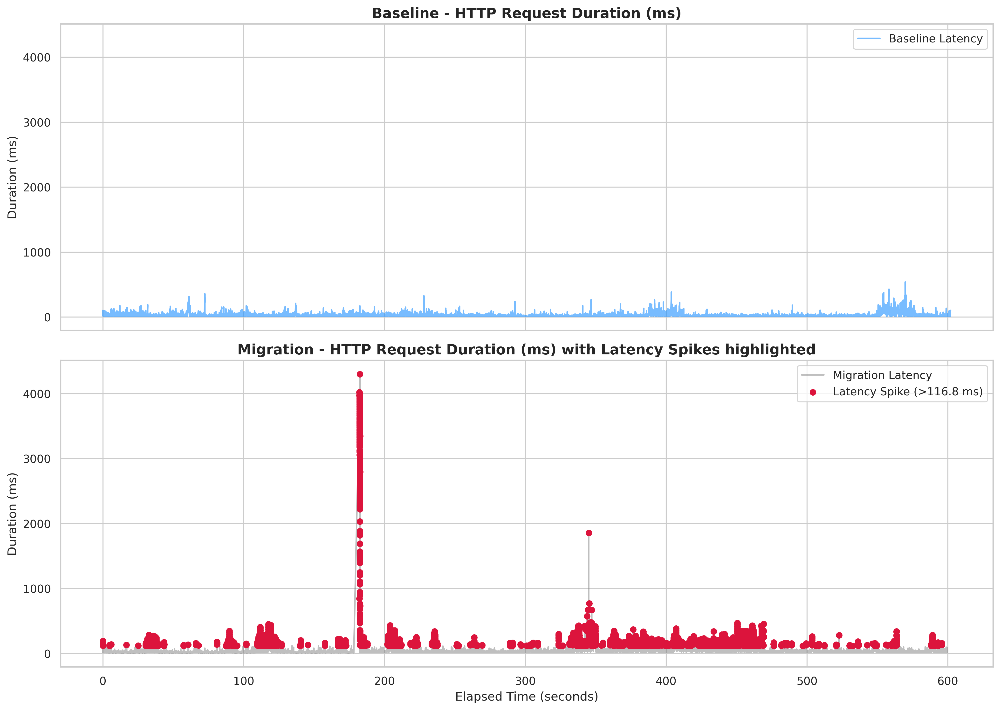
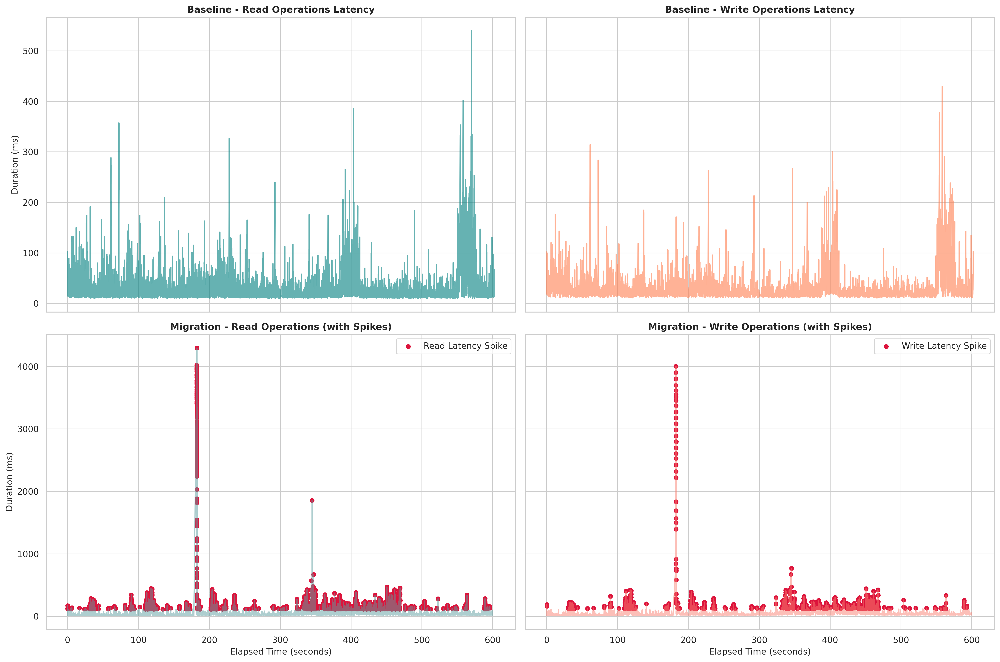

## 무중단 EC2 MySQL -> RDS MySQL 마이그레이션 결과 보고서

### 1. 마이그레이션 개요 및 컷오버(Cut-over) 실행 기록

본 마이그레이션은 서비스 영향을 최소화하고 사용자 경험을 유지하기 위해 무중단으로 DB 아키텍처를 전환하는 것을 목표로 진행되었습니다. 기존 MySQL 트랜잭션을 완전히 종료한 뒤 라우팅 대상을 전환하기 위해 `ReentrantReadWriteLock` 기반의 쓰기 배리어(Write Barrier)를 적용했습니다.

```bash
# 1. 사전 검증 완료 및 애플리케이션 쓰기 배리어(Write Barrier) 획득
[2026-10-29T04:14:34+0000] validating EC2 MySQL and RDS connectivity
[2026-10-29T04:14:34+0000] acquiring the shared application write barrier
[2026-10-29T04:14:34+0000] sealing EC2 MySQL writes
[2026-10-29T04:14:34+0000] waiting for RDS to apply binlog.000012:3425918

# 2. 원본(EC2) 봉인 완료 및 RDS 승격 진행
[2026-10-29T04:14:35+0000] source sealed and RDS drain completed
[2026-10-29T04:14:35+0000] stopping forward replication and promoting RDS

# 3. RDS 승격 완료, 역방향 복제(Reverse Replica) 검증 및 트래픽 전환
[2026-10-29T04:14:38+0000] RDS promotion completed; application barrier remains held
[2026-10-29T04:14:38+0000] EC2 reverse replica is healthy from mysql-bin-changelog.002381:30853373
[2026-10-29T04:14:38+0000] switching datasource to RDS while writes remain blocked
[2026-10-29T04:14:38+0000] verifying application read/write health against RDS

# 4. 쓰기 배리어 해제 및 서비스 재개
[2026-10-29T04:14:38+0000] releasing the application write barrier
[2026-10-29T04:14:38+0000] traffic is now served by RDS without dropping queued writes

```

### 2. 성능 지표 및 Read/Write 지연(Latency) 분석

트래픽 전환 시점 전후로 시행한 k6 부하 테스트 결과, 에러율 0.0%를 유지하며 트랜잭션 유실 없이 전환에 성공했습니다.<br>
*(부하 주입 시 [db_migration.js](../../loadtest/migration/db_migration.js)를 10분 간 실행했습니다.)*

| 구분 | 총 요청 수 | 평균 응답시간 | 95% 응답시간 | 99% 응답시간 | 최대 응답시간 | 에러율 |
| --- | --- | --- | --- | --- | --- | --- |
| **Baseline** | 24,002 | 28.98 ms | 77.85 ms | 154.93 ms | 539.93 ms | 0.0% |
| **Migration** | 23,966 | 65.69 ms | 161.86 ms | 320.86 ms | 4,299.08 ms | 0.0% |

작업 유형별로 세분화한 결과, 마이그레이션 컷오버 구간에서 쓰기 트래픽(최대 4,003.69 ms)뿐만 아니라 **읽기 트래픽(최대 4,299.08 ms) 역시 동일한 수준의 지연 스파이크를 경험**한 것으로 확인되었습니다.


*(그림 1: Baseline 대비 마이그레이션 컷오버 구간의 전체 트래픽 지연 스파이크)*


*(그림 2: 읽기(Read)와 쓰기(Write) 작업군별 최대 지연 시간 동기화 현상)*

### 3. 전면 지연(Stop-the-world) 발생 원인 분석

읽기와 쓰기 요청 모두에서 평균 응답 시간이 약 2.2배 상승하고 4초 이상의 지연 스파이크가 발생한 것은 DB 인스턴스의 리소스(CPU/네트워크) 병목 현상이 아닙니다. 이는 애플리케이션 레벨에서 데이터 정합성을 완벽하게 보장하기 위해 도입한 **`ReentrantReadWriteLock`의 독점 락(Exclusive Lock) 메커니즘에 의한 의도된 통제 결과**입니다.

* **동기화된 락 대기**: 설계상 일반적인 모든 DB 접근(조회 및 수정)은 트랜잭션 실행 구간에서 `ReadLock`을 획득해야 합니다. 그러나 DB 라우팅을 RDS로 전환하는 마이그레이션 작업은 `WriteLock`을 획득합니다.


* **Stop-the-world 작동**: `04:14:34`부터 `04:14:38`까지 마이그레이션 스크립트가 `WriteLock`을 점유한 4초 동안, 새로운 `ReadLock` 발급이 전면 차단되었습니다.


* 이로 인해 쓰기 요청뿐만 아니라 단순 조회(GET) 요청마저 락을 획득하지 못하고 배리어에서 대기하게 되었으며, 해당 4초의 홀딩 시간이 k6 지표의 최대 응답 시간(약 4.3초)으로 그대로 반영되었습니다. 37건의 Dropped Iteration 역시 이 4초의 대기열 적체 과정에서 발생한 클라이언트 사이드 타임아웃입니다.

### 4. 한계점 및 향후 아키텍처 개선 방향

이번 마이그레이션은 단 1ms의 데이터 불일치도 허용하지 않는 엄격한 락 정책을 통해 결점 없이 이관을 완료했습니다. 하지만 서비스의 비즈니스 특성을 고려했을 때 이러한 '전면 차단' 방식은 오버엔지니어링의 측면이 존재합니다.

결제나 금전적 트랜잭션이 수반되지 않는 단순 물물교환 플랫폼의 특성상, 완벽한 정합성보다는 사용자 경험(가용성)이 더 중요할 수 있습니다. 마이그레이션과 같은 컷오버 상황에서 조회수 카운팅, 단순 상품 목록 조회, 내 정보 읽기와 같이 약간의 오차나 지연된 동기화(Eventual Consistency)가 허용되는 읽기 트래픽까지 4초 이상 전면 차단한 것은 비효율적입니다.

향후 유사한 인프라 작업이나 배포 시에는 DB의 모든 연결 경로를 하나의 락으로 묶는 대신, **크리티컬한 쓰기 트래픽에만 배리어를 적용하고 단순 읽기 요청은 캐시(Redis)를 우선 반환하거나 즉시 응답할 수 있도록 분리 통제하는 유연한 서킷 브레이커(Circuit Breaker) 정책**을 도입하여 읽기 가용성을 극대화할 계획입니다.